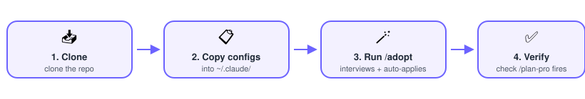

[English](README.md) | [ภาษาไทย](README.th.md) | [简体中文](README.zh-Hans.md) | **日本語** | [Español](README.es.md) | [한국어](README.ko.md) | [Português (Brasil)](README.pt-BR.md) | [Français](README.fr.md) | [Deutsch](README.de.md) | [Русский](README.ru.md)

<div align="center">


[](LICENSE)
<!-- gen:skills-count-badge:start -->[](#global-configskills)<!-- gen:skills-count-badge:end -->
[](#top)
[](#caveat-this-is-one-persons-setup)


</div>

**ジャンプ:** [クイックスタート](#はじめにクイックスタート) · [中身の構成](#中身の構成) · [ライセンスとクレジット](#ライセンスとクレジット)

ある個人のClaude Codeセットアップ(グローバル指示、スキル、フック、ナレッジボルト)を持ち運び可能な形にまとめたスナップショットで、真新しいClaude Codeインスタンスが同じワークフローの習慣をブートストラップできるようにパッケージ化されています。これは**そのまま実行する設定ファイルではなく、自分向けに手を加えるためのテンプレート**です。

<details>
<summary>フルバージョンを読む</summary>

ある個人のClaude Codeセットアップを持ち運び可能な形にまとめたスナップショットです。グローバル指示、エンジニアリングルール、**厳選されたスキル66個**（自作20個 — うち15個はゼロから執筆、5個はサードパーティ製ツールを包むラッパーとして自作、2個は既存スキルを改変したもの、残りはアップストリームのリポジトリから採用したもので、各スキルの出典は`sources.json`に記載）、実際のメモリ例、スキルの出典管理台帳、プロジェクト横断のナレッジボルトが含まれます。すべては、新しいマシンで真新しいClaude Codeインスタンス（あるいはそれをセットアップする本人）が同じワークフローの習慣と能力をブートストラップできるようにパッケージ化されています。これは**そのまま実行する設定ファイルではなく、自分向けに手を加えるためのテンプレート**です。個人を特定できる情報はすべて除去してプレースホルダーに置き換えてあり、一部のセクションは説明されているツール自体を導入して初めて意味を持ちます。

</details>

## こんな人向けです

| 向いている | 向いていない |
|---|---|
| Claude Codeを毎日使っていて、コスト別のモデルルーティング、gitの安全フック、プランレビューループといった出来合いの習慣がほしい | ワンクリックで使える設定がほしい。ここにあるものはそのままでは動かず、すべて読んで手を入れる前提です |
| 他の人のセットアップを読んで、自分に合う部分だけ取り入れるのが好き | Windows前提でもタイ語前提でもない既定値が、あらゆる箇所で必要。作者の環境はWindowsとタイ語・英語で、一部のセクションにそれが表れています |
| AIコーディングツールを複数使っていて、持ち運べる`AGENTS.md`がほしい | リリースやサポートのある、保守されたプロダクトがほしい。これは個人のスナップショットです |

## はじめに(クイックスタート)

> **近道:** リポジトリをクローンしてClaude Codeで開き、`/adopt`を実行してください。これがインタビュー形式で必要事項を尋ね、下記のステップ2・3・5・7を代わりに実行してくれます。ステップ6(プラグインエコシステム自体のインストール)は意図的に`/adopt`の対象外としてあります。これだけは自分で行う必要があります。

<p align="center"></p>

| # | ステップ | 場所 |
|---|---|---|
| 1 | リポジトリをクローンする | 対象マシンの好きな場所で構いません |
| 2 | 決める: ローカルAI(Ollama)による事前圧縮を使うか? | [オプション: ローカルAI](#オプション-ローカルaiによる事前圧縮)を参照 |
| 3 | 設定を`~/.claude/`にコピーする | `CLAUDE.md`, `agents/*.md`, `hooks/*.py`, `skills/*`, `tools/` — **先に「Installed Plugins」を書き直す** |
| 4 | 設定をマージする | `global-config/settings.example.json` → `~/.claude/settings.json`(`<YOUR_HOME>`を置き換え) |
| 5 | プレースホルダーを一括置換する | 完全なリストは[導入方法](#導入方法)ステップ8を参照 |
| 6 | プラグインエコシステムをインストールする | [別途インストールが必要なもの](#別途インストールが必要なもの)を参照 |
| 7 | `notes/` + `memory-examples/`をコピーする(任意) | 自分のセカンドブレイン・ボルト/自動メモリフォルダ |
| 8 | 確認する | 実装計画を依頼してみる — `/plan-pro`は呼ばれるか? |

マルチエージェント環境(Codex、Cursor、Gemini CLIなど)を使っている場合は、`global-config/AGENTS.md`も各プロジェクトのルートにコピーしてください — 詳細は[他のAIコーディングツールとの互換性](#他のaiコーディングツールとの互換性)を参照。

このREADMEの残りの部分では、各要素を詳しく説明します。

## 中身の構成

```
claude-clone-template/
├── README.md
├── LICENSE                                # MIT license for this repo's own content
├── ATTRIBUTION.md                         # Credits for the upstream repos the third-party skills were adopted from
├── .claude/commands/adopt.md              # Run `/adopt` in this repo to interview + auto-apply the steps below
├── global-config/
│   ├── CLAUDE.md                          # Global instruction file (~/.claude/CLAUDE.md equivalent)
│   ├── AGENTS.md                          # Claude Code以外のエージェント(Codex、Cursor、Gemini CLIなど)向けの、CLAUDE.mdの持ち運び可能なサブセット
│   ├── settings.example.json              # Sanitized ~/.claude/settings.json — hooks, plugins, model default
│   ├── agents/                            # 3 pinned-model subagent definitions (opus, haiku-batch, fable-medium)
│   ├── hooks/block-dangerous-git.py       # PreToolUse gate that asks before risky git commands
│   ├── hooks/graphify-auto-update.py      # PostToolUse hook — 編集のたびにgraphifyのナレッジグラフを同期し続ける
│   ├── rules/ecc-common/                  # 10 engineering-discipline rule files (ecc plugin ecosystem)
│   ├── skills/                            # 66 curated skill folders (the actual SKILL.md instructions, not just an index — see sources.json for provenance)
│   ├── SKILLS_INDEX.md                    # Personal index of installed skills/plugins + when to use which
│   ├── memory-examples/                   # 7 real auto-memory entries showing the memory system's format/patterns
│   ├── templates/                         # 2 starter templates to copy into a new repo (project-CLAUDE.md, conventions.md)
│   └── tools/
│       ├── skill-update-check/
│       │   ├── check.ps1                  # Weekly update checker — reads sources.json from this same folder
│       │   └── sources.json               # Real provenance manifest: 66 personal skills + 3 pip + 2 npm + 1 binary tool
│       └── ollama/ollama-digest.ps1       # On-demand local-model pre-digest helper (see the Ollama section below)
└── notes/                                 # 3 notes: a personal cross-project "second brain" vault (example content)
```

### `global-config/CLAUDE.md`
このセットアップの中核です。以下を規定しています。

- **コスト意識型のモデルルーティング** — メインループはSonnetがオーケストレーターとなり、タスクの難易度に応じてHaiku/Opus/Fableのサブエージェントに委譲します。誰が生ファイルを読み、誰が結論だけを読むかについての厳格なルールも含みます。
- **重い実行処理のオフロード** — 大きな作業を別セッションに切り出し、現在のセッションを肥大化(および課金増大)させないようにします。
- **計画ワークフロー** — `/plan-pro`をデフォルトのプランナーとして使用します。
- **セカンドブレイン・ボルトの慣習** — 「単一リポジトリに紐づいているか?」という一つのルールで、ボルトに置くべきかリポジトリのdocs/ADRに置くべきかを判断します。
- **Gitセーフティフック** — 破壊的なgitコマンドの実行前に確認を挟むPreToolUseゲートです。
- **graphify自動同期フック** — 編集のたびにナレッジグラフを最新の状態に保つPostToolUseフックで、編集自体をブロックすることはありません。
- **シェルの落とし穴** — BashツールとPowerShellツールのヒアドキュメント構文の違いに関するルール(Windows特有の痛みから学んだもの)。
- **コンテキストの自己監視** — Claudeがいつ`/compact`を自発的に提案すべきかの基準。
- **AIらしさを消す文章ルール** — 下書きされた文章を人間が書いたように見せるためのタイ語・英語のフルルールセット(避けるべき語彙、構造パターン、レジスターの一致)。このファイルの中で最も分量が多く、最も汎用性の高い部分です。裏付けとなる詳細は`memory-examples/`にあります。
- **PRはドラフト作成をデフォルトとする**、**cron/クラウドエージェントのスケジューリングは事前確認が必要**、**長時間実行コマンド中は簡潔な実況のみ**、並列セッション向けの**claude-in-chromeの共有タブグループの落とし穴**、Supabaseを使うプロジェクト向けの**プロアクティブなSupabase RLSチェック**。

### `global-config/rules/ecc-common/`
ecc(everything-claude-code)プラグインエコシステムからの一般的なエンジニアリング規律です。TDDワークフロー、イミュータビリティ、コミット形式、セキュリティチェックリスト、コードレビューの重大度レベル、エージェントへの委譲などが含まれます。eccも併せて導入している場合のみ役立ちます(下記「別途インストールが必要なもの」参照)。

### `global-config/skills/`
厳選された`SKILL.md`フォルダが66個(スキルによっては補助スクリプト・リファレンス・データファイルも同梱)あり、ライティング/マーケティング関連(copywriting、copy-editing、hallmark、marketing-council、pricingなど)、エンジニアリングプロセス(debug-mantra、poka-yoke、second-brain、dependency-audit、secrets-auditなど)、デザイン(design-system、ui-ux-pro-max、banner-design、mobbin-referencesなど)、そしてClaude Code自体を管理するためのメタスキル(skillify、grilling、second-brain、graphify、plan-pro、shipping-a-branchなど)をカバーしています。`poka-yoke`、`plan-pro`、`shipping-a-branch`はゼロから自作したものです。`graphify`、`dembrandt`、`markitdown`、`mobbin-references`は自作のラッパースキルで、SKILL.md自体はオリジナルですが、裏側で使うツールはサードパーティ製です(`ATTRIBUTION.md`にクレジット、`sources.json`にバージョン履歴あり)。`deslop-defaults`は改変版(`ibelick/ui-skills`から抽出しスタック非依存に書き直したもの)です。残りはアップストリームのリポジトリから採用したものです — スキルごとの出典は`sources.json`、アップストリームへのクレジットは`ATTRIBUTION.md`を参照してください。これらは単なるスキルの説明ではなく、実際に再利用可能なプロンプトエンジニアリングの成果物です。`~/.claude/skills/`にコピーすればすぐに動作します。

Full skill table (generated from the manifest): see the English [README](README.md#global-configskills).

### `global-config/memory-examples/`
オーナーのClaude Code自動メモリシステムからの実際のエントリーが7件(プロジェクト固有の事実ではなく、持ち運び可能な「自分の仕事の仕方」に関する習慣)含まれています。セッション間メッセージングの命名規則を曖昧さなく決める話、ローカルOllamaを事前圧縮として使うパターン、「スキルノートブックを更新する」が具体的に何を意味するかというルール、シェルのクォーティングに関する落とし穴(`\b`が静かにバックスペース文字になってしまう問題)、コンテキストの肥大化をどれだけ積極的に削るかについてのフィードバック、そしてCLAUDE.mdにあるAIらしさを消す文章ルールの裏付けとなる完全な詳細(語彙表 + 修正前後の例)をタイ語・英語の両方で収録しています。これらは、内容そのものと同じくらい、良いメモリエントリーの「形」(ルール + 理由 + 適用方法)を示すために存在しています — メモリが全体のワークフローにどう組み込まれるかは`global-config/rules/ecc-common/`を、ローカルメモリとグローバルメモリの使い分けはCLAUDE.mdの「จำ/บัญญัติ」セクションを参照してください。

### `global-config/tools/skill-update-check/sources.json`
オーナーの実際のスキル/ツール採用台帳です — 自作および改変したものを含む、66個の個人用スキルすべてと、pipパッケージ3個、npmパッケージ2個、バイナリツール1個についての実際の出典データ(ソースリポジトリのURL、インストールメモ、バージョン履歴)が記載されています。`check.ps1`と組み合わせることで、`claude-clone-template`の導入者は、`~/.claude/skills/`にコピーしたスキルのアップストリームでの更新を、オリジナルのオーナーと同じ方法で追跡できます。`last_seen_commit`の値は、受け取った側が一度`check.ps1 -Ack`を実行して自分の基準点を確立するまでは、ほとんどが`unknown`または古いままです。

### `global-config/templates/`
新規リポジトリの初期セットアップ時にコピーする小さなスターターファイルが2つあります(`project-CLAUDE.md`、`conventions.md`)。45行以下の「ルーター」役プロジェクトCLAUDE.mdと、コンベンション/グリーンゲートのテンプレートです。それぞれに、ブートストラップ対象のスタック向けの穴埋め式PRESET(現状はPythonウェブの例のみ)を示すコメントブロックがあります。必要なスタックがあれば、同じ要領で自分用のプリセットを追加してください。

### `notes/`
オーナーのObsidianセカンドブレイン・ボルトからのサンプルコンテンツです。ローカルOllamaモデルの一覧、ブックマークしたリポジトリ、その他の雑多なリファレンスノートが含まれます。これらは、プロジェクト横断のボルトに「どんな種類のもの」を置くべきかを示すものであり、必ず持つべき普遍的な項目ではありません。構造の発想だけ残し、中身は時間をかけて自分のものに置き換えてください。

## 導入方法

1. **`global-config/CLAUDE.md`をコピー**して、自分の`~/.claude/CLAUDE.md`にします。既存のものとマージするか、完全に置き換えるかは任意です。まず読んでから、自分に当てはまらないセクションは削除してください。**このファイルに手を加える前に、まず「Installed Plugins」セクションを書き直してください** — 現状は特定のプラグイン(superpowers、ecc、pordee、lazyweb、andrej-karpathy-skills)がインストールされ有効になっていると主張しており、Claudeにインストールについて言及しないよう指示しています。これは元のオーナーにとっては事実ですが、あなたにとってはそうではありません。実際のプラグイン一覧に置き換えるか、何かをインストールするまでは削除しておいてください。
2. **`global-config/agents/*.md`をコピー**して`~/.claude/agents/`に、**`global-config/hooks/*.py`をコピー**して`~/.claude/hooks/`に置きます(2つのフック両方です)。これらがあって初めて、CLAUDE.md内のモデルルーティングルール、gitセーフティゲート、graphify自動同期フックが単なる文章ではなく実際に機能します。
3. **`global-config/skills/*`をコピー**して`~/.claude/skills/`に置きます。これが実際の価値の大部分を占めます — 66個の、単なる説明ではない、実際に動作するスキルフォルダです。
4. **`global-config/settings.example.json`をマージ**して自分の`~/.claude/settings.json`にします(まず`<YOUR_HOME>`を実際のホームパスに置き換えてください)。すでにsettings.jsonがある場合は上書きせずマージし、`hooks.PreToolUse`のエントリーや、`enabledPlugins`から必要なものを取り込んでください。同梱のフックコマンドはWindowsの`py`ランチャーを使っています。macOS/Linuxではまず`python3`に変更してください。
5. **`global-config/rules/ecc-common/`をコピー**して`~/.claude/rules/`に置くのは、eccプラグインを導入する場合のみです。それ以外はスキップしてください。
6. **`global-config/memory-examples/*.md`をコピー**して、適用したいプロジェクトの自動メモリフォルダに置きます(Claude Codeの自動メモリはプロジェクトごとで、`~/.claude/projects/<project>/memory/`にあります)。あるいは参考として読み、自分のものをゼロから書いてください。
7. **`notes/`をコピー**して自分のセカンドブレイン・ボルトの場所(Obsidianやプレーンなmarkdownツールが見られる任意のフォルダ)に置きます。ボルトが不要なら丸ごとスキップして構いません。
8. **すべてのプレースホルダーを一括置換**します — これが最も重要なステップです。
   - `<YOUR_USERNAME>`、`<YOUR_HOME>` → 実際のWindows/システムのユーザー名とホームパス
   - `<YOUR_VAULT_PATH>` → セカンドブレイン・ボルトを置いている(あるいは置く予定の)場所
9. **`global-config/tools/`をコピー**します(`skill-update-check/`と、Ollamaを残した場合は`ollama/`の両方)。コピー先は`~/.claude/tools/`です。その後、**`sources.json`で自分の基準点を設定**します。スキルをコピーした後に一度`check.ps1 -Ack`を実行し、`last_seen_commit`が元のオーナーの履歴ではなく、自分が管理する起点を反映するようにしてください。

## 別途インストールが必要なもの

このリポジトリに含まれているのは、スキルエコシステムへの**参照とルール**であり、エコシステム自体ではありません。CLAUDE.mdの指示が意味を持つためには、以下をインストールする必要があります。

- **superpowers** (obra/superpowers) — brainstorming、writing-plans、TDD、デバッグ用スキル
- **ecc / everything-claude-code** (affaan-m/ECC) — エージェント、スキル、コマンド、MCPサーバー
- `SKILLS_INDEX.md`に記載されている、他に必要だと判断したプラグイン

新しいマシンでは、Claude Codeのプラグインシステム経由でこれらをインストールし、実際にインストールした内容と`SKILLS_INDEX.md`を照合してください。

---

## サブスクリプションプランとFable 5.2ティアについての注意

`CLAUDE.md`のモデルルーティングのはしごは`fable-medium`サブエージェントを頂点としており、これには**Max**プランが必要です。**Pro**プランではspawnしようとしても単に失敗します。`/adopt`はこれについて尋ね、代わりに修正してくれます。

<details>
<summary>Maxプランでない場合の手動対応</summary>

`CLAUDE.md`内のモデルルーティングのはしごは、`fable-medium`サブエージェントを頂点としています。これは最もコストが高い層で、難しい判断のための優先的なアドバイザー/セカンドオピニオン用モデルとして使います。元のオーナーは**Max**プランを利用しており、そこではこのモデルが使えます。もし**Pro**プラン(あるいはFable 5.2にアクセスできないプラン)であれば、`fable-medium`をspawnしようとしても単に失敗します。

`CLAUDE.md`をそのままコピーする前に、自分がどのプランかを確認してください。Fable 5.2にアクセスできない場合は:
- モデルルーティングのセクションから、`fable-medium`に関する段落と「สุดบันได」(はしごの頂点)の箇条書きを削除してください。
- はしごの上限を`opus`で止まるように変更してください — 難易度・重要度の高い作業をOpusにエスカレーションするというルーティングロジック自体は変わらず有効です。ただ、Opusより上のレベルがなくなるだけです。
- `global-config/agents/fable-medium.md`は`~/.claude/agents/`にコピーする対象から外してください。

`/adopt`はインタビューの一環としてこれを尋ね、代わりに編集してくれます。手作業でファイルをコピーする場合は、自分でこの編集を行ってください。そうしないと、Claudeが自分のプランでは届かないサブエージェントをspawnしようとし続けてしまいます。

</details>

---

## オプション: ローカルAI(Ollama)による事前圧縮

無料で、多少の情報損失を伴う事前圧縮層です — ローカルモデルが、長く重要度の低いテキストを有料モデルのコンテキストに入る前に要約します。能力は何も追加せず、純粋にコスト削減のためのものです。スキップ可能で、他の部分はこれに依存していません。

<details>
<summary>詳細 — 使うかどうか</summary>

元のセットアップでは、ローカルのOllamaモデルを**無料で、多少の情報損失を伴う事前圧縮層**として使っています。長く重要度の低いテキスト(ログ、冗長なドキュメント)を、有料モデルのコンテキストに入れる**前**にローカルモデルに通して要約させる仕組みです。コストのはしごの中では**Haikuより下**に位置づけられており、ルーティングの一階層ではありません — ツールアクセスもリポジトリコンテキストもなく、テキストの入出力のみです。コストは節約できますが、能力は何も追加しません。このリポジトリの他の部分はこれに依存していません。

**つまり、自分で答えるべき問いはこれです: このためにローカルのOllamaモデルをセットアップしたいか?**

### 「いいえ」の場合
このセクション全体をスキップしてください。`CLAUDE.md`のコピーからOllamaに関する段落を削除し、`notes/local-ollama-models.md`を削除してください。それ以外は問題なく動作します。

### 「はい」の場合
1. [ollama.com](https://ollama.com)から**Ollamaをインストール**します。
2. **モデルストアの置き場所を決めます。** モデルは大きく(27Bモデルで数十GB)、デフォルトの保存先はシステムドライブです(Windowsでは`%USERPROFILE%\.ollama`)。システムドライブの空きが少ない場合は、より大きいドライブにストアを移してください — 元のセットアップでは、まさにこの理由で`<YOUR_DRIVE>:\ollama`を使っています。Windowsでは、モデルをプルする前に`OLLAMA_MODELS`環境変数を選んだパスに設定してください。他のプラットフォームにも同様の環境変数やシンボリックリンクの方法があります。
3. **少なくとも1つの汎用instructモデルをプルします**(例: `ollama pull qwen2.5:7b-instruct`、あるいは同程度の約7〜9Bのinstructモデル。高速に動作しつつ要約には十分な性能です)。`notes/local-ollama-models.md`にある元の構成は、一つの例を示しています: 品質重視の重い27Bモデル、速度/推論/コード用の7〜9B中規模モデル、そして視覚対応モデル(`llava:7b`)が1つ。このリストは参考であって、そのまま揃えるべき買い物リストではありません。
4. **使い方のパターンを覚えます:** ファイルをパイプで渡し、要約を受け取る —
   ```powershell
   Get-Content <file> | ollama run <model> "<instruction>"
   ```
   (ファイルはパイプで渡してください。長いプロンプトを引数に詰め込まないでください。)
5. **唯一の絶対ルールを知っておいてください:** ローカルモデルの出力は**決して正しい情報の保証にはなりません**。これは重要度の低いテキストに対する情報損失を伴う圧縮です。もし何かの判断がその内容に依存するなら、有料モデルは常に元のテキストを読むべきです。

これは完全にオプションであり、スキップ可能です。存在意義は、大量のテキストにかかるトークンコストを削減することだけです。

</details>

---

## 他のAIコーディングツールとの互換性

1つではなく2つのファイルが同梱されています: `CLAUDE.md`(Claude Code専用)と`AGENTS.md`(持ち運び可能な部分 — [agents.md](https://agents.md)、Codex、Cursor、Gemini CLI、Copilotも読み込みます)。

<details>
<summary>2つのファイルがどう連携するか</summary>

このテンプレートは**Claude Code**専用に作られていますが、Claude Code 2.1.277(2026年9月)以降は、Claude Code自体もプロジェクトに`CLAUDE.md`が無い場合のフォールバックとして[`AGENTS.md`](https://agents.md)を読み込むようになりました — これはCodex CLI、Cursor、Gemini CLI、GitHub Copilotがすでに読み込んでいるのと同じ規約です。このテンプレートが1つではなく2つのファイルを同梱しているのはそのためです。

- **`global-config/CLAUDE.md`** — フルセットアップです。コスト意識型のモデルルーティング、`/plan-pro`、スキルカタログ、フック、サブエージェントルーティングなど、Claude Codeの中でしか意味を持たないものすべてを含みます。
- **`global-config/AGENTS.md`** — 持ち運び可能なサブセットです(コーディングスタイル、gitワークフロー、テスト、コードレビュー、セキュリティチェックリスト、共通パターン)。Claude Code専用の仕組みはすべて取り除かれています。任意のプロジェクトに置けば、AGENTS.mdに対応した任意のエージェント(Claude Codeを含む)が読み込みます。

プロジェクトに**両方**のファイルがある場合、Claude Codeは`CLAUDE.md`を読み込み`AGENTS.md`は無視します — 2つは統合されないので、AGENTS.mdが存在するからといってClaude Code固有のルールが適用されると期待しないでください。他のツール(Codex、Cursorなど)は`AGENTS.md`しか読み込みません。これらのツールは`CLAUDE.md`、`Skill`ツール、`settings.json`のフック、サブエージェント定義という概念自体を持たないため、これらは何があってもClaude Code専用のままです。

AGENTS.mdのサブセットより多くを手作業で移植したい場合、対応できるものもあります。
- `global-config/skills/<name>/SKILL.md`にある各スキルは、単なるmarkdownの指示書です。他のツールのカスタムインストラクションに貼り付けることはできますが、自動トリガーは失われますし、同梱のスクリプトはそのツールが実行できるシェルを前提としています。
- フック(`settings.json`)とサブエージェントファイル(`agents/*.md`)はClaude Code専用で、移植できる同等の仕組みは他にありません。

日常的にCodex/Cursor/Gemini CLIを使っている場合、`AGENTS.md`だけでエンジニアリング規律のルールがそのまま手に入ります。リポジトリの残り(スキル、フック、.docxの修正方法など)は、コピー&ペーストして使えるリファレンス資料として引き続き存在します。

</details>

## ライセンスとクレジット

- このリポジトリ自身の内容はMITライセンスです。[LICENSE](LICENSE)を参照してください。
- スキルの大半は他の人の公開成果に由来します。クレジットとスキルごとの出典は[ATTRIBUTION.md](ATTRIBUTION.md)と`global-config/tools/skill-update-check/sources.json`にあります。
- 上流のライセンス文と著作権表示は[THIRD_PARTY_LICENSES.md](THIRD_PARTY_LICENSES.md)にまとめています。ライセンスファイルのない上流リポジトリが2つあり、削除依頼への対応の注記とともにそこに載せています。
- クレジットの漏れや、削除してほしいスキルを見つけたら、issueを開いてください。対応します。

---

## 注意: これは一個人のセットアップです

このスナップショットは、Windowsマシンを使うタイ語・英語のバイリンガルユーザーという、特定のワークフローから生まれたものです。それはいたるところに表れています — CLAUDE.md内のバイリンガルなセクションや、PowerShellとBashの間の落とし穴などです。

役に立つ部分だけ採用し、不要な部分は捨ててください。これらはどれも規範的なベストプラクティスではなく、一個人にとってうまくいった方法を、持ち運べる程度にはきちんと書き留めたものです。本当の価値は個々のルールそのものではなく、このシステムの「形」(コストによるルーティング、重い作業のオフロード、知識ごとに置き場所を一つに決めること、破壊的なコマンドに対する安全ゲート)にあります。
